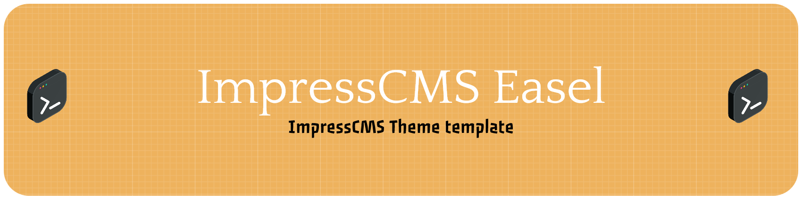

# ImpressCMS Easel

[](https://github.com/ImpressCMS/impresscms-easel/actions/workflows/ci.yml)
[](https://www.impresscms.org/)
[](https://vite.dev/)

A template repository for building ImpressCMS themes. Just like a painter's easel gives the painter a place to work,
Easel gives you a place to build your theme: Smarty templates, plain CSS and JavaScript go in, an installable theme
comes out, and every change is checked for accessibility.

- **Vite 8** bundles and minifies the CSS and JavaScript with hashed file names and links the bundles in the
  templates.
- **Smarty-aware template minification** that never breaks template fragments.
- **A theme skeleton** with every ImpressCMS block zone, a skip link and RTL support, in plain CSS. Add a
  framework when you need one.
- **Checks**: WCAG contrast of the palette, the build output, and page tests with Playwright and axe-core against a
  running site.
- **GitHub workflows** for CI, release zips and Conventional Commits.

## Start a new theme

1. Click **Use this template** on GitHub and clone your new repository.
2. Set `name` in `package.json` to the folder name of your theme, e.g. `mytheme`. The release zip uses it.
3. Install the dependencies. Node.js 20.19+ or 22.12+ is required.

   ```bash
   npm install
   ```

4. Replace `src/shot.gif` (the screenshot that the themes block shows, 300×200) and the images in `src/img/`.

## Development

| Path | Contents |
| --- | --- |
| `src/theme.html` | The page layout |
| `src/templates/` | Partials of the layout: header, footer and a block zone |
| `src/modules/` | Module template overrides, see [src/modules/README.md](src/modules/README.md) |
| `src/js/theme.js` | Entry point: imports the styles and the scripts of the theme |
| `src/css/theme.css` | Theme styles, with the palette as custom properties in `:root` |
| `src/img/`, `src/shot.gif` | Static files, copied as they are |
| `src/index.html` | Static mockup of the layout, only used by the dev server |
| `build/vite-plugin-icms-theme/` | The Vite plugin that builds the theme, see its [README](build/vite-plugin-icms-theme/README.md) |
| `scripts/check-contrast.mjs` | WCAG contrast gate for the colour pairs in `tests/contrast.config.mjs` |
| `tests/` | Build output test and page tests |

```bash
npm run dev              # dev server with the static mockup
npm run build            # the installable theme in dist/
npm run watch            # rebuild on every change
npm test                 # unit tests, contrast check, build and build output test
npm run test:pages       # page tests against a running site
```

Copy the contents of `dist/` to `htdocs/themes/<name>` and select the theme in the ImpressCMS preferences. To
build straight into a local ImpressCMS installation and rebuild on every change:

```bash
ICMS_THEME_OUT_DIR=/path/to/htdocs/themes/mytheme npm run watch
```

Smarty keeps compiled copies of the templates in `templates_c/`. Remove the ones that belong to the theme after
changing a template.

### Linking the bundles

A template links an entry with an HTML comment. The build replaces it with the stylesheet and script tags of the
hashed bundles, prefixed with `<{$icms_imageurl}>`:

```html
<{$icms_module_header}>
<!-- vite: js/theme.js -->
```

Other files are linked from the theme folder directly, e.g. `<{$icms_imageurl}>img/logo.svg`. The build output test
fails when such a file does not exist in `dist/`.

### Adding a CSS framework

Install the framework from npm and import it before the theme styles in `src/js/theme.js`, so the theme can
override it. For Bulma:

```bash
npm install bulma
```

```js
import 'bulma/css/bulma.css'
import '../css/theme.css'
```

For Bootstrap, install `bootstrap` (and `sass` to use its SCSS sources) and import
`bootstrap/dist/css/bootstrap.css` and `bootstrap` the same way.

### An admin theme

To style the ImpressCMS administration, add `src/theme_admin.html` with its own entry, e.g. `src/js/admin.js` and
`<!-- vite: js/admin.js -->`, and add that entry to `entries` in `vite.config.js`.

## Checks

### Contrast

`npm run check:contrast` checks the WCAG 2.1 contrast of the colour pairs in `tests/contrast.config.mjs`: 4.5:1
for text, 3:1 for UI components. Colours written as `var(--name)` are read from `:root` in `src/css/theme.css`, so a
palette change is checked automatically. Add a pair for every new combination of text and background.

### Page tests

`npm run test:pages` opens the pages in `tests/pages/config.mjs` in a real browser on a site that runs the built
theme, at 375, 1280 and 1920px. It checks that:

- the page is served with the stylesheet of the built theme and has at most one `h1`;
- the page does not scroll horizontally;
- there are no console errors and no axe-core violations for WCAG 2.1 A/AA (at 375 and 1280px);
- the skip link is the first focusable element and jumps to the main content.

```bash
ICMS_THEME_OUT_DIR=/path/to/htdocs/themes/mytheme npm run build
ICMS_TEST_URL=http://mysite.test npm run test:pages
```

Playwright drives a browser that is already installed: Chrome by default, set `ICMS_TEST_BROWSER=msedge` for Edge.
The tests are skipped when the site is not reachable. Add the pages of the modules you override templates for to
`pages`. Findings that come from content or from the core, and not from the theme, go into `axeKnown` with a reason.

## GitHub workflows

| Workflow | When | What |
| --- | --- | --- |
| `ci.yml` | Push to `main`, pull requests | `npm test` on Node 22 and 24, the built theme as an artifact |
| `release.yml` | A release is created | `npm test`, then a zip with the theme folder is attached to the release |
| `conventional-commits.yml` | Pull requests | Commit messages follow [Conventional Commits](https://www.conventionalcommits.org/) (`feat`, `fix`, `chore`, `docs`, `test`, `refactor`) |

## License

[MIT](LICENSE)

---

**ImpressCMS Easel** is maintained by the [ImpressCMS Project](https://github.com/ImpressCMS).
For documentation and community support, visit [impresscms.org](https://www.impresscms.org/).
